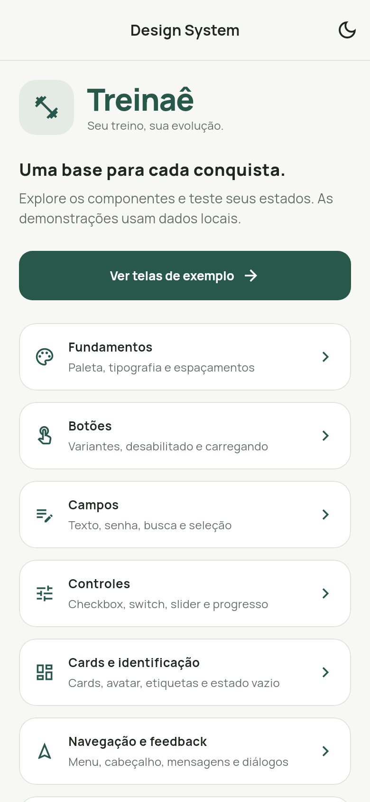

# Treinaê — Design System

Esta branch `design-system` contém a biblioteca de componentes Flutter e o sample app do Treinaê.

- **main:** reservada ao desenvolvimento do aplicativo principal.
- **design-system:** componentes, temas, documentação e galeria interativa.

## Executar o sample app

Mantenha a estrutura das pastas e execute na raiz deste repositório:

```bash
cd treinae_design_system/example
flutter pub get
flutter run -d chrome
```

No Android Studio, abra `treinae_design_system/example`, selecione um emulador e execute `lib/main.dart`.

Requisitos: Flutter 3.35+ e Dart 3.9+. As telas do sample são demonstrações locais; não dependem de backend.

[Documentação e componentes](treinae_design_system/README.md) · [Validação](treinae_design_system/VALIDACAO.md)

## Prévia



**Aluno:** Marcelo Negrão  
**Professor:** Malfatti  
**Disciplina:** Mobile 2
