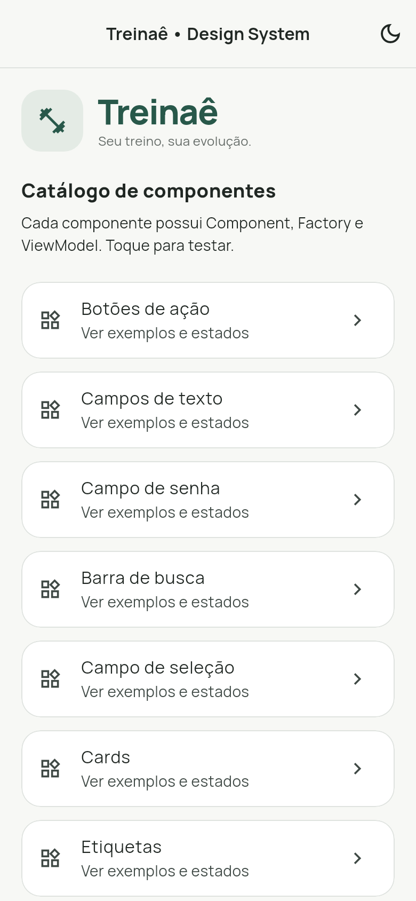
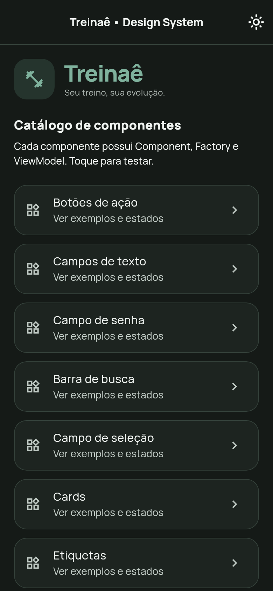

# Treinaê — Design System

Design System Flutter do aplicativo de controle de musculação **Treinaê**, com 22 grupos de componentes e um aplicativo de demonstração (sample app).

**Aluno:** Marcelo Negrão  
**Professor:** Malfatti  
**Disciplina:** Mobile 2  
**Versão:** 2.0.0

## Abrir no Android Studio

1. Baixe o ZIP da branch `design-system` e extraia, ou clone usando o comando abaixo.
2. No Android Studio, clique em **Open** e abra a pasta que contém **`pubspec.yaml`, `lib/` e `android/`**.
3. No terminal dessa pasta, execute `flutter pub get`.
4. Inicie um emulador Android, selecione o dispositivo e execute **`lib/main.dart`**.

O projeto fica diretamente na raiz da branch. O ZIP do GitHub cria uma pasta externa, normalmente `Treina--design-system`; abra essa própria pasta. Não é necessário entrar em outra pasta `treinae_design_system`.

## Executar pelo terminal

Requisitos: Flutter 3.35+ e Dart 3.9+. Para Android, configure o Android SDK e um emulador ou dispositivo.

```bash
git clone --branch design-system --single-branch https://github.com/Marcelomasc12/Treina-.git
cd Treina-
flutter pub get
flutter run
```

Para executar no navegador:

```bash
flutter run -d chrome
```

Após extrair um ZIP, abra o terminal na pasta que contém `pubspec.yaml` e execute os mesmos comandos Flutter. A primeira instalação de dependências requer internet.

## Organização

| Caminho na raiz | Responsabilidade |
| --- | --- |
| `lib/main.dart` | Inicia o sample app e configura tema e idioma. |
| `lib/common/constants/` | Espaçamentos e raios compartilhados. |
| `lib/common/theme/` | Cores, estilos de texto e temas claro/escuro. |
| `lib/components/` | Uma pasta por componente com Component, Factory e ViewModel. |
| `lib/screens/` | Catálogo e telas de demonstração dos componentes. |
| `assets/fonts/` | Fontes Manrope e licença. |
| `test/` | Testes de arquitetura, interações e layout. |
| `android/`, `ios/`, `web/`, `windows/`, `linux/`, `macos/` | Projetos de plataforma. |
| `pubspec.yaml` | Dependências e configuração do projeto Flutter. |

Cada **Component** desenha o elemento visual. A **Factory** cria o componente com sua configuração. O **ViewModel** armazena essa configuração de forma imutável, com campos `final`. As telas de demonstração mantêm seu próprio estado e recebem eventos por callbacks.

Por exemplo, `lib/components/action_button/` reúne `action_button_component.dart`, `action_button_factory.dart` e `action_button_view_model.dart`. Sua demonstração está em `lib/screens/sample_action_button_screen.dart`.

## Temas e componentes

Os temas claro e escuro estão em [app_theme.dart](lib/common/theme/app_theme.dart). As cores ficam em [app_colors.dart](lib/common/theme/app_colors.dart), e a tipografia em [app_text_styles.dart](lib/common/theme/app_text_styles.dart). As fontes Manrope estão incluídas nos assets, com licença.

O catálogo inclui botões, campos de texto e senha, busca, seleção, cards, etiquetas, avatar, marca, estado vazio, títulos, progresso, meta mensal, checkbox, switch, slider, cabeçalho, navegação, feedback e componentes de treino e histórico.

As demonstrações usam dados locais e não dependem de uma API. O aplicativo inicia por `lib/main.dart`.

## Verificar e compilar

Execute na raiz, onde está `pubspec.yaml`:

```bash
flutter analyze
flutter test
flutter build web --no-tree-shake-icons
```

A opção `--no-tree-shake-icons` preserva integralmente as fontes de ícones e evita a falha de otimização observada no SDK da entrega original.

A versão revisada teve análise sem problemas, 50 testes aprovados e compilação web concluída antes desta reorganização de pastas. Esses testes não foram executados novamente nesta movimentação. Android, iOS e desktops não foram compilados ou executados em dispositivo nesta entrega.

## Documentação

- [Arquitetura](ARQUITETURA.md)
- [Resultados da validação original](VALIDACAO.md)

## Prévias

| Tema claro | Tema escuro |
| --- | --- |
|  |  |

## Branches

- **`design-system`**: componentes, temas, sample app e documentação.
- **`main`**: desenvolvimento do aplicativo principal.
